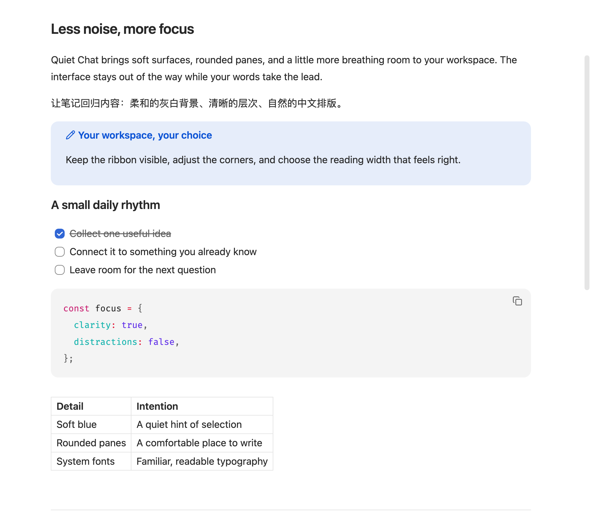
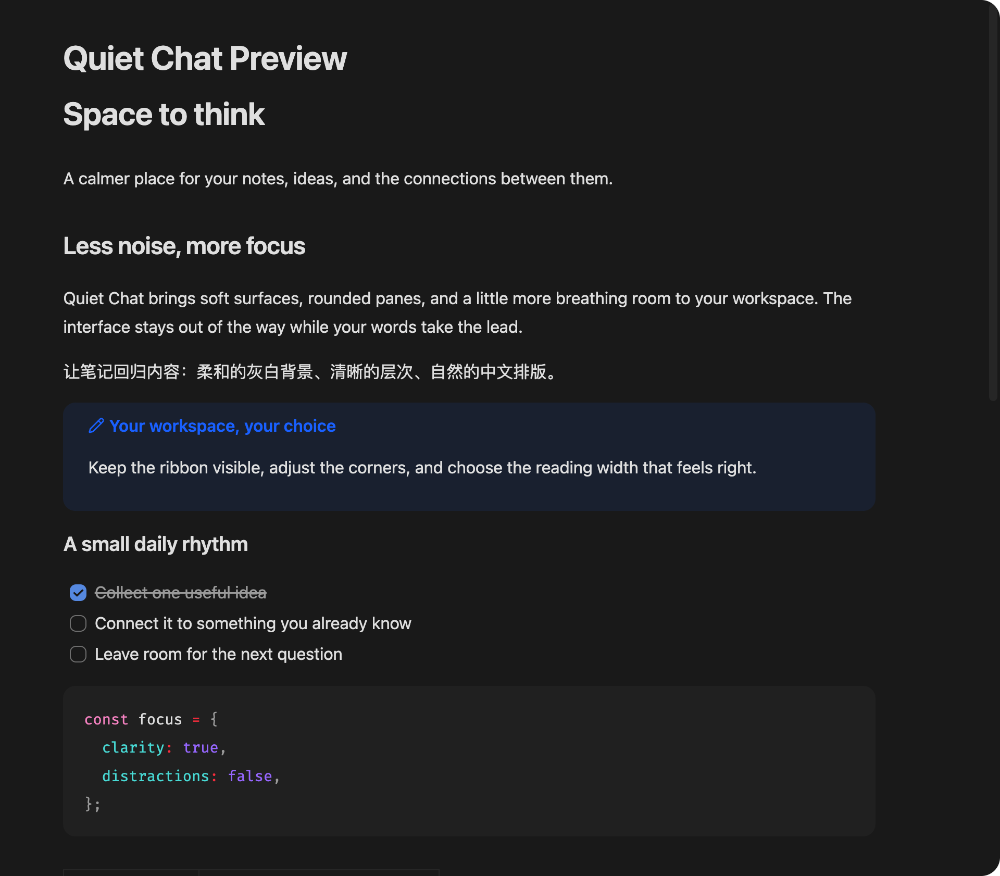

# Quiet Chat

A calmer, ChatGPT-inspired workspace for Obsidian: rounded editor panes, soft gray sidebars, light blue selection, and aligned tabs. Includes light and dark appearances.

为 Obsidian 带来更安静的界面：圆角编辑区、浅灰侧栏、淡蓝选中状态、统一对齐的顶部栏。支持浅色与深色模式。

## Preview / 预览

Screenshots use synthetic example content, not a real vault.



<details><summary>Dark appearance / 深色预览</summary>



</details>

## Features / 功能

- Rounded panes, menus, quick switcher and code blocks.
- File-tab icons matching the sidebar and Quick Switcher, with vertical centering and cleanup on unload.
- Vertically aligned Quick Switcher file icons, reusing Material Icon Theme when enabled and falling back to a standard file icon.
- Aligned file-tree padding with constrained spacer widths to prevent sideways scrolling.
- Typora GitHub-inspired document proportions: 16px text, 1.6 line height, 0.8em paragraph spacing, and 36/28/24/20px heading levels. Implemented for Reading view and Live Preview, with borderless headings to match Quiet Chat.
- Adjustable pane radius, readable text width, text size, line height, paragraph spacing, heading scale and heading spacing.
- Separate controls for list item spacing, nested indentation and vertical spacing between list levels. Paragraph spacing applies to Reading view; the editor preserves source blank lines.
- Grouped settings with Chinese and English on separate lines.
- Inset document scroll viewports keep native scrollbars clear of pane corners.
- Optional system fonts for text and UI; your code font is preserved.
- Independent switches for hiding the ribbon, status bar and note header.
- **The ribbon is not hidden by default.**
- Appearance can be toggled with a command; disabling the plugin removes its body classes and option styles.
- No network calls, telemetry, note edits, or changes to core settings and shortcuts.

## Install / 安装

Requires **Obsidian 1.13.0+ on desktop**. Mobile is not supported in this release.

### Manual

1. Download `main.js`, `manifest.json`, and `styles.css` from [Releases](https://github.com/tarnish233/obsidian-quiet-chat/releases).
2. Create `<vault>/.obsidian/plugins/quiet-chat/` and put those three files inside it.
3. Reload Obsidian, then enable **Quiet Chat** under Community plugins.
4. Use **Settings → Quiet Chat** to customize the appearance.

### BRAT

If you use [BRAT](https://github.com/TfTHacker/obsidian42-brat), add `tarnish233/obsidian-quiet-chat` as a beta plugin repository.

This repository is not yet listed in Obsidian's community plugin directory. BRAT installation has not been separately tested.

## Recommended setup / 建议配置

- Use Obsidian's **Default** theme. Other themes may override or conflict with this plugin.
- Enable **Editor → Readable line length** for the text-width setting to apply.
- If the ribbon is missing, turn on **Appearance → Show ribbon** and disable this plugin's **Hide ribbon** option.
- The plugin follows Obsidian's light/dark mode. It does not force a color mode.
- Existing custom snippets can affect spacing and colors. Disable conflicting snippets individually.
- Material file icons are an optional, separate plugin; Quiet Chat bundles no third-party icons.

If migrating from the earlier local **Quiet Chat theme**, switch to the Default theme first. Otherwise that theme will remain visible when this plugin is disabled. Previous core-setting changes (hidden ribbon, font settings, etc.) are not automatically restored by this plugin.

## Development

```sh
npm ci
npm run check
```

`src/theme.css` is the base design; the build scopes every selector to `body.quiet-chat` so styles cannot remain active after unloading. `src/typography.css` provides the document typography; `src/options.css` provides setting-controlled styles. `main.js` and `styles.css` are generated release artifacts.

Checks cover TypeScript compilation, settings validation, selector isolation, and cleanup across load/toggle/popout/unload. Desktop light/dark mode, tab alignment and split panes were visually checked during development. Obsidian UI selectors may change in future releases; full third-party theme compatibility is not guaranteed.

## Attribution

Inspired by the visual language of a user-provided ChatGPT desktop screenshot. An independent project, not affiliated with or endorsed by OpenAI or Obsidian. No OpenAI logos, screenshots, fonts, or other product assets are distributed.

MIT license.
